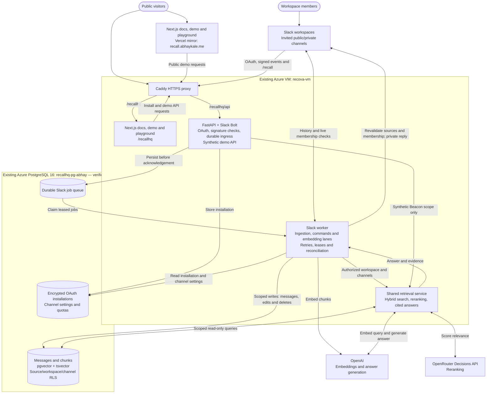
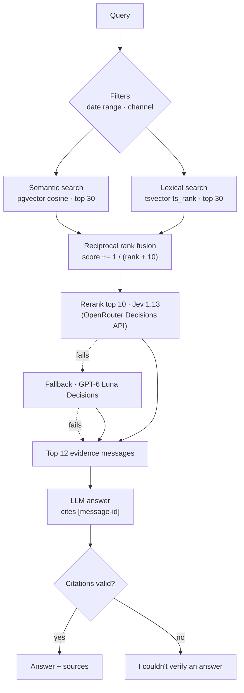
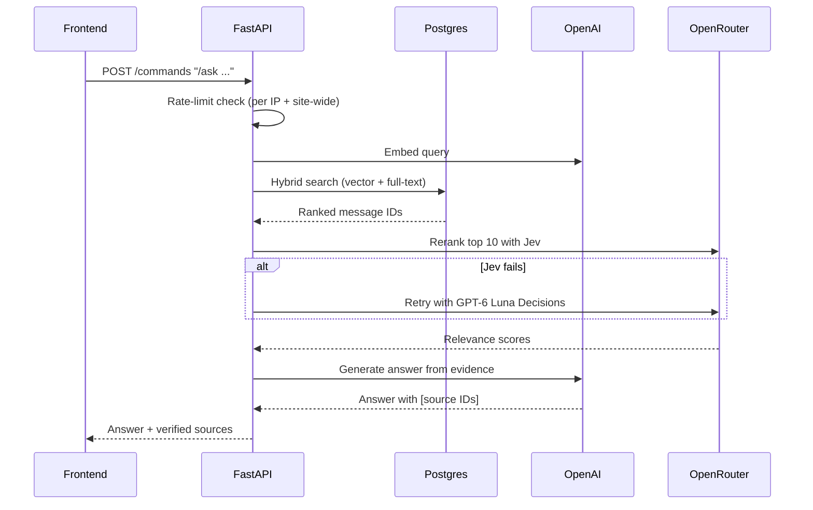

<div align="center">


# RecallHQ

**Ask your team chat. Get grounded, cited answers.**

Hybrid retrieval and grounded answers over Slack conversations, with a public synthetic demo.

RecallHQ also runs as a multi-workspace **Slack bot**. Invite it into a channel to
import available history and capture new messages, then use `/recall ask`,
`/recall search`, or `/recall catchup` for private, cited results. Workspace and
channel access are enforced independently of the public demo.

See [Slack setup, commands, testing, and deployment](docs/slack-bot.md). Generate
an app manifest with `uv run python -m recallhq.cli slack-manifest --base-url <HTTPS-API-URL>`.

[](https://recall.abhaykale.me)


</div>

---

## Commands

| Command | What it does |
| --- | --- |
| `/recall ask <question> [in:#channel]` | Private, grounded answer with links to Slack messages |
| `/recall search <terms> [in:#channel]` | Matching messages in channels you belong to |
| `/recall catchup YYYY-MM-DD YYYY-MM-DD [in:#channel]` | Date-bounded recap (up to 32 days) |
| `/recall summarize <message-link>` | Indexed thread summary |
| `/recall decisions [in:#channel]` | Decisions from the last seven days |
| `/recall status` | Channel imports and embedding backlog |
| `/recall sync #channel` | Admin: retry history import |
| `/recall forget #channel` | Admin: confirm disabling ingestion and purging channel data |

Use `/recall help` for syntax. The anonymous Beacon demo supports `/ask`,
`/search`, and `/catchup` over synthetic messages.

## Architecture



The API acknowledges verified Slack requests after persisting their jobs. The
worker imports available channel history, captures live changes, and performs
model work separately. Slack queries enforce current membership before retrieval
and delivery; the public site queries only the synthetic Beacon corpus. Runtime
database logins have separate read/write roles, and installations retain their
own encrypted bot tokens.

## Retrieval pipeline



### Reranking

`/ask` and `/search` rerank the top 10 RRF hits with the OpenRouter **Decisions API**.
One request scores every candidate against a 4-level relevance rubric (unrelated → directly answers);
hits are sorted by that score, with ties kept in RRF order. `/catchup` is not reranked.

1. **Jev 1.13** (`typesafe/jev-1.13-20260917`) is tried first.
2. If it errors or times out, **GPT-6 Luna Decisions** (`openai/gpt-6-luna-decisions-20261006`) scores the same request.
3. If both fail, or `OPEN_ROUTER` is unset, results keep plain RRF order.

| Setting | Default |
| --- | --- |
| `OPEN_ROUTER` | OpenRouter API key (reranking is off when empty) |
| `RERANK_MODEL` | `typesafe/jev-1.13-20260917` |
| `RERANK_FALLBACK_MODEL` | `openai/gpt-6-luna-decisions-20261006` |
| `RERANK_TOP_K` | `10` |

Still planned for evaluation: a local cross-encoder (`BAAI/bge-reranker-v2-m3`) on the same candidates.

## `/ask` request flow



## Quickstart

```bash
uv sync --locked
docker compose up -d
uv run python -m recallhq.cli migrate
uv run python -m recallhq.cli ingest data/synthetic/corpus.jsonl
uv run uvicorn recallhq.api:app --reload
uv run pytest -q
```

Set `OPENAI_API_KEY`, `DATABASE_URL` and optionally `OPEN_ROUTER` in `.env` (local defaults match `compose.yaml`).
Ingest is re-runnable: unchanged chunks keep their embeddings.
Anonymous commands are limited to 3/min and 20/day per IP, plus 200/day site-wide.

For the frontend, see [frontend/README.md](frontend/README.md). It adapts the MIT-licensed
[Slack clone](https://github.com/sanidhyy/slack-clone) into a public, read-only Beacon workspace.

## Deployment

| Piece | Where |
| --- | --- |
| Frontend and docs | Azure VM at [/recallhq](https://recova.indiasouthcentral.cloudapp.azure.com/recallhq); Vercel project `recallhq` remains available |
| API and Slack worker | `recallhq-slack-api` and `recallhq-slack-worker` on `recova-vm`; Caddy routes `/recallhq/api/*` |
| Database | Azure PostgreSQL Flexible Server `recallhq-pg-abhay` (PG 16, B1ms, 32 GB, `vector` allowlisted) in `recallhq-rg` |
| Security | DB firewall allows only the VM's IP; verified TLS, separate read/write logins, and workspace/channel RLS; secrets live in `slack-runtime.env` on the VM, outside the repo |

See the [Azure deployment runbook](deploy/azure/README.md) for releases, checks,
and Slack endpoint cutover. The docs site includes installation, command
reference, permissions, a synthetic demo, and an anonymous playground.

## Layout

```
src/recallhq/   API, CLI, ingestion, retrieval
src/recallhq/slack/ OAuth, signed ingress, incremental ingestion, commands, worker
migrations/     Postgres schema (pgvector, full-text index)
scripts/        Corpus generation & validation
evals/          Evaluation queries and reference checks
frontend/       Next.js + Convex chat UI
```

## License

[MIT](LICENSE)
