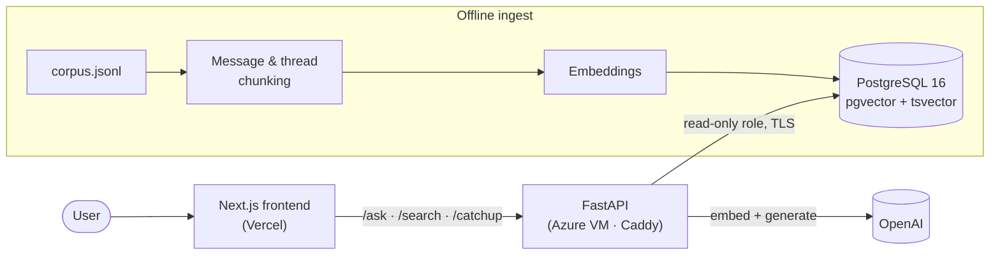
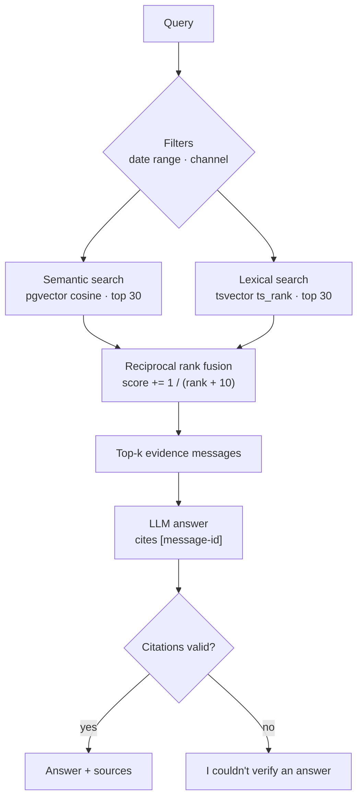
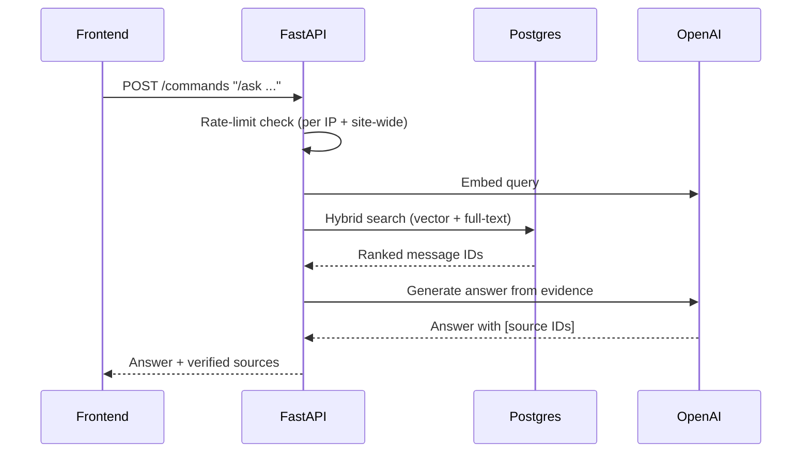

<div align="center">


# RecallHQ

**Ask your team chat. Get grounded, cited answers.**

Hybrid retrieval and grounded answers over a synthetic Slack/Discord-style workspace.

[](https://recallhq-black.vercel.app)


</div>

---

## Commands

| Command | What it does |
| --- | --- |
| `/ask <question>` | Grounded answer with links to source messages |
| `/search <terms>` | Matching messages across channels |
| `/catchup YYYY-MM-DD YYYY-MM-DD [#channel]` | Date-bounded recap (up to 32 days) |

## Architecture



## Retrieval pipeline



## `/ask` request flow



## Quickstart

```bash
uv sync --locked
docker compose up -d
uv run python -m recallhq.cli migrate
uv run python -m recallhq.cli ingest data/synthetic/corpus.jsonl
uv run uvicorn recallhq.api:app --reload
uv run pytest -q
```

Set `OPENAI_API_KEY` and `DATABASE_URL` in `.env` (local defaults match `compose.yaml`).
Ingest is re-runnable: unchanged chunks keep their embeddings.
Anonymous commands are limited to 3/min and 20/day per IP, plus 200/day site-wide.

For the frontend, see [frontend/README.md](frontend/README.md). It adapts the MIT-licensed
[Slack clone](https://github.com/sanidhyy/slack-clone) into a public, read-only Beacon workspace.

## Deployment

| Piece | Where |
| --- | --- |
| Frontend | Vercel project `recallhq` |
| API | `recallhq-api` container on the `recova-vm` Docker network; Caddy routes `/recallhq/api/*` |
| Database | Azure PostgreSQL Flexible Server `recallhq-pg-abhay` (PG 16, B1ms, 32 GB, `vector` allowlisted) in `recallhq-rg` |
| Security | DB firewall allows only the VM's IP; API uses a read-only role with verified TLS; secrets live in `runtime.env` on the VM, outside the repo |

## Layout

```
src/recallhq/   API, CLI, ingestion, retrieval
migrations/     Postgres schema (pgvector, full-text index)
scripts/        Corpus generation & validation
evals/          Evaluation queries and reference checks
frontend/       Next.js + Convex chat UI
```

## License

[MIT](LICENSE)
