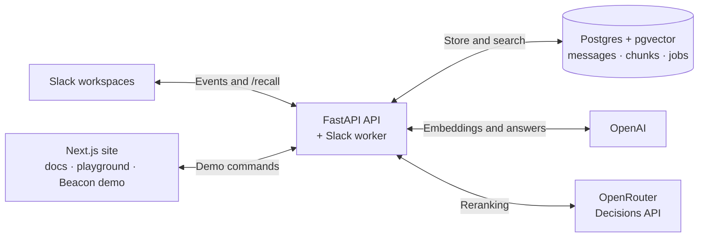
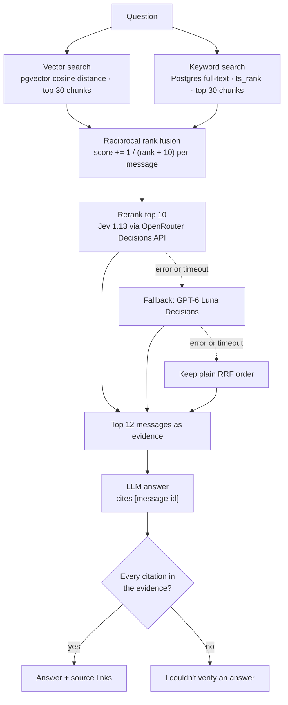

<div align="center">


# RecallHQ

**Ask your team chat. Get answers with citations.**

### [Read the docs](https://recall.abhaykale.me/docs) · [Try the playground](https://recall.abhaykale.me/playground) · [Open the Beacon demo](https://recall.abhaykale.me/workspace/beacon/channel/eng)


</div>

---

RecallHQ is a retrieval-augmented generation (RAG) system for Slack-style team chat.
It indexes channel messages and threads in Postgres. It finds relevant messages with
hybrid search (vectors plus keywords) and answers questions only from those messages,
citing each one. If the citations don't check out, it gives no answer.

It runs in two ways:

- **Slack bot.** It can be installed in more than one workspace. Invite it into a
  channel, and it imports the history Slack makes available and captures new
  messages. Results are private and only cover channels you belong to.
- **Public demo.** An anonymous, read-only workspace called "Beacon" with about 2,200
  synthetic messages, so anyone can try it without connecting real data.

## Contents

- [What it does](#what-it-does)
- [How it works](#how-it-works)
- [Evaluation](#evaluation)
- [Quickstart](#quickstart)
- [Slack bot setup](#slack-bot-setup)
- [Deployment](#deployment)
- [Project layout](#project-layout)
- [License](#license)

## What it does

| Command | What it does |
| --- | --- |
| `/recall ask <question> [in:#channel]` | Private answer with links to the Slack messages it used |
| `/recall search <terms> [in:#channel]` | Ranked matching messages from channels you belong to |
| `/recall catchup YYYY-MM-DD YYYY-MM-DD [in:#channel]` | Recap of a date range (up to 32 days) |
| `/recall summarize <message-link>` | Summary of an indexed thread |
| `/recall decisions [in:#channel]` | Decisions from the last seven days |
| `/recall status` | Import progress and embedding backlog per channel |
| `/recall sync #channel` | Admin: retry the history import |
| `/recall forget #channel` | Admin: stop ingesting a channel and delete its data (asks to confirm) |
| `/recall help` | Syntax and access rules |

The public Beacon demo supports `/ask`, `/search` and `/catchup` over the synthetic
messages. Anonymous use is limited to 3 commands per minute and 20 per day per IP,
plus 200 per day across the whole site.

## How it works

### Architecture



- **The API and the worker are separate processes.** The API checks Slack's request
  signature, saves the job in Postgres, and acknowledges right away. The worker then
  imports history, applies edits and deletions, computes embeddings and runs
  commands. Jobs are deduplicated, leased, and retried a limited number of times.
- **Ingestion is thread-aware.** Every message becomes its own chunk. Each thread also
  becomes a "thread chunk" made of the root message and its replies. Threads longer
  than about 600 tokens (counted with tiktoken `o200k_base`) are split; each part
  keeps the root and the previous reply for context. Chunks are embedded with
  `text-embedding-3-small` (1536 dimensions).
- **Ingest can be re-run safely.** A chunk's ID comes from the messages it covers.
  When a chunk's text hasn't changed, its stored embedding is kept, so only new or
  edited chunks are embedded again.
- **Access control happens in the database.** Migrations turn on Postgres row-level
  security (RLS) for `messages` and `chunks`. There are two restricted roles:
  `recallhq_reader` for queries and `recallhq_ingestor` for the Slack worker. Read
  policies filter by source, workspace and allowed channels. Slack queries check
  that the user still belongs to the channel before searching and again before
  replying. The public site can only read the synthetic Beacon corpus. Each
  workspace's bot token is stored encrypted.

### Retrieval pipeline

This is how `/ask` and `/search` work (`src/recallhq/retrieval/service.py`):



1. **Vector search.** The question is embedded, and the 30 chunks closest by cosine
   distance are returned. There is no approximate (ANN) vector index yet, so this is
   an exact scan.
2. **Keyword search.** `lexical_query()` lowercases the question, removes common
   English stop words, and joins the remaining words with OR (for example,
   `command | fixed | local | 28p01 | postgres | failure`). Postgres matches that with
   `to_tsquery('simple', ...)` and ranks with `ts_rank`, so chunks that match more
   words rank higher. One exact term, such as an error code, is enough to match.
3. **Fusion.** Each chunk adds `1 / (rank + 10)` to every message it contains. Both
   lists have equal weight. Messages are sorted by their total score.
4. **Reranking.** The top 10 messages are sent to the OpenRouter Decisions API in one
   request. Each message gets a score on a four-level scale, from "unrelated" to
   "directly answers". Messages are sorted by score, and ties keep their RRF order.
   Jev 1.13 is tried first, then GPT-6 Luna Decisions. If both fail, or if
   `OPEN_ROUTER` is not set, the RRF order is kept. `/catchup` is not reranked.
5. **Answering.** The top 12 messages go to the generation model (`gpt-5.4-mini` by
   default). It is told to answer only from those messages and to cite each claim
   with a message ID. If it cites an ID that wasn't in the evidence, or cites nothing
   without saying it couldn't find an answer, the reply becomes
   "I couldn't verify an answer from the available messages."

Rerank settings:

| Setting | Default |
| --- | --- |
| `OPEN_ROUTER` | OpenRouter API key; reranking is off when empty |
| `RERANK_MODEL` | `typesafe/jev-1.13-20260917` |
| `RERANK_FALLBACK_MODEL` | `openai/gpt-6-luna-decisions-20261006` |
| `RERANK_TOP_K` | `10` |

## Evaluation

Full method, metric definitions and limitations are in
**[docs/evaluation.md](docs/evaluation.md)**.

- **Data:** 2,233 synthetic messages from a fictional student team across 5 channels,
  and 44 hand-written questions (38 answerable, 6 unanswerable).
- **What has been measured:** lexical-only retrieval (the keyword search alone), on
  the 38 answerable questions.

| Config | Recall@10 | Recall@20 | MRR@20 |
| --- | --- | --- | --- |
| Lexical-only (current) | 0.616 | 0.675 | 0.460 |
| Lexical-only, before the keyword fix | 0.000 | 0.000 | 0.000 |
| Dense-only, hybrid RRF, hybrid + rerank | not run yet | not run yet | not run yet |

**What isn't measured yet:** dense-only, hybrid and hybrid + rerank retrieval, and
the end-to-end answer metrics (citation validity, answer rate, abstention). These
runs need query embeddings, and the OpenAI key currently in use doesn't have access
to the embedding model. The script is ready (`scripts/run_eval.py`), and the results
will be added once it can run.

**The keyword fix.** Keyword search used to go through `websearch_to_tsquery`, which
requires every word in the question, including words like "which" and "the". It
returned zero results for all 44 questions, so "hybrid" search was really
vector-only. The current OR-based query fixed this.

The data is synthetic, and the question set is small and was written within this
project, so treat these numbers as a sanity check, not a benchmark.

## Quickstart

Requires Python 3.12, [uv](https://docs.astral.sh/uv/) and Docker.

```bash
uv sync --locked
docker compose up -d                       # Postgres 16 + pgvector
uv run python -m recallhq.cli migrate
uv run python -m recallhq.cli ingest data/synthetic/corpus.jsonl
uv run uvicorn recallhq.api:app --reload
uv run pytest -q
```

Copy `.env.example` to `.env` and set `OPENAI_API_KEY`. `DATABASE_URL` defaults to
the database in `compose.yaml`. `OPEN_ROUTER` is optional and turns on reranking.

To run the frontend (docs, playground and Beacon demo), see
[frontend/README.md](frontend/README.md). It is adapted from an MIT-licensed
[Slack clone](https://github.com/sanidhyy/slack-clone).

## Slack bot setup

See **[docs/slack-bot.md](docs/slack-bot.md)** for creating the Slack app, running
it locally through a tunnel, the full command reference, ingestion and recovery
behaviour, database roles, and tests. To generate the app manifest:

```bash
uv run python -m recallhq.cli slack-manifest --base-url <HTTPS-API-URL>
```

## Deployment

| Part | Where |
| --- | --- |
| Website (docs, playground, demo) | Vercel at [recall.abhaykale.me](https://recall.abhaykale.me), also served from the Azure VM at [/recallhq](https://recova.indiasouthcentral.cloudapp.azure.com/recallhq) |
| API and Slack worker | Docker containers on an Azure VM, behind Caddy at `/recallhq/api/*` |
| Database | Azure Database for PostgreSQL Flexible Server (PG 16, `vector` extension) |
| Security | Database firewall allows only the VM; TLS is verified; separate read and write logins with RLS; secrets live in an env file on the VM, outside the repo |

The [Azure runbook](deploy/azure/README.md) covers releases, migrations, the Caddy
config, health checks and rollback.

## Project layout

```
src/recallhq/
  api.py            FastAPI app: demo endpoints, /commands, rate limits
  cli.py            migrate, ingest, slack-init, slack-manifest, slack-worker
  ingestion/        Chunking, embedding, corpus validation
  retrieval/        Hybrid search, RRF, reranking, cited answers
  slack/            OAuth, signed requests, commands, incremental ingestion, worker
migrations/         Postgres schema, full-text index, RLS policies and roles
scripts/            Synthetic corpus generation and checks, evaluation runner
evals/              Evaluation questions, reference checks and results
tests/              Unit tests and Postgres integration tests
frontend/           Next.js site: docs, playground, Beacon demo
deploy/azure/       Azure compose file and runbook
docs/               Slack bot guide, evaluation report
```

## License

[MIT](LICENSE)
